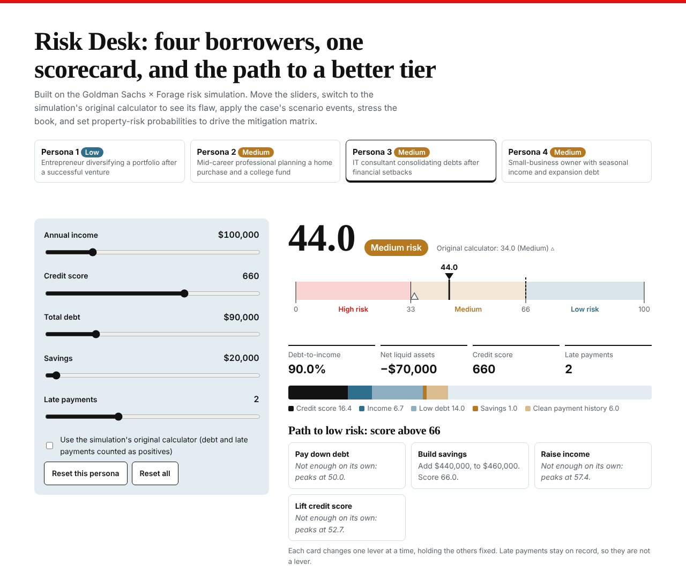
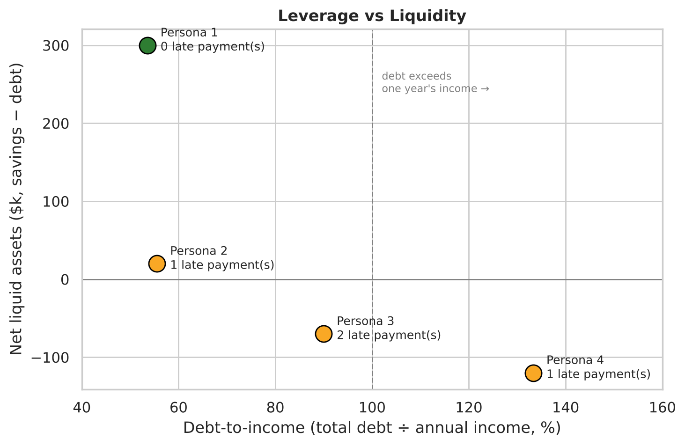
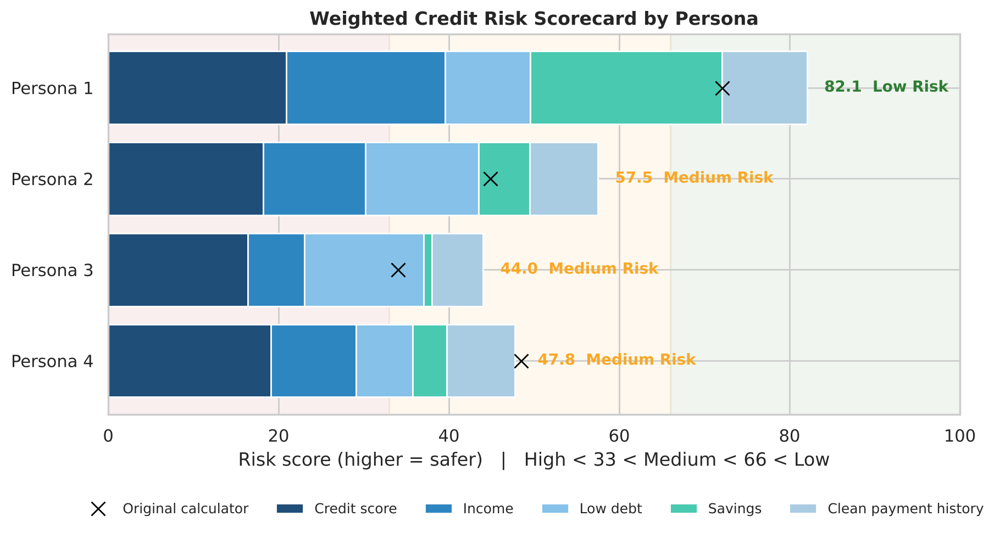
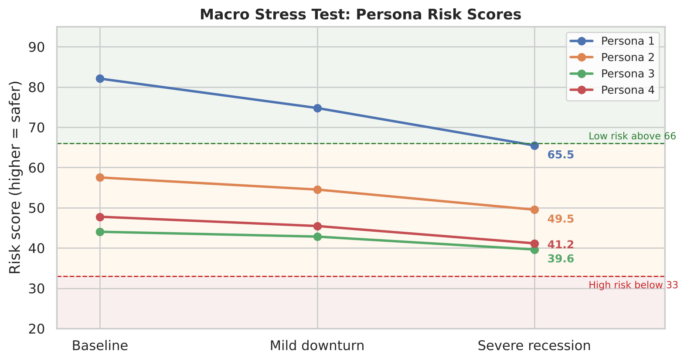
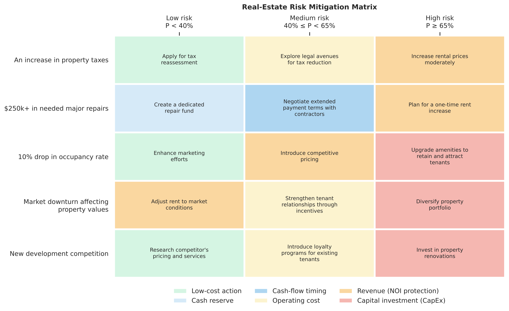
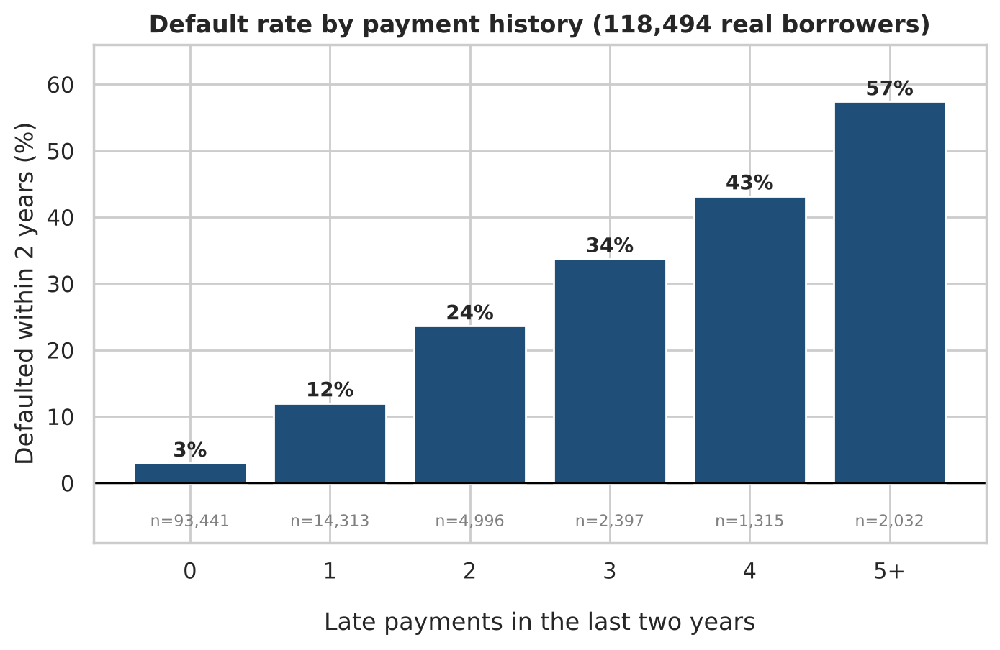
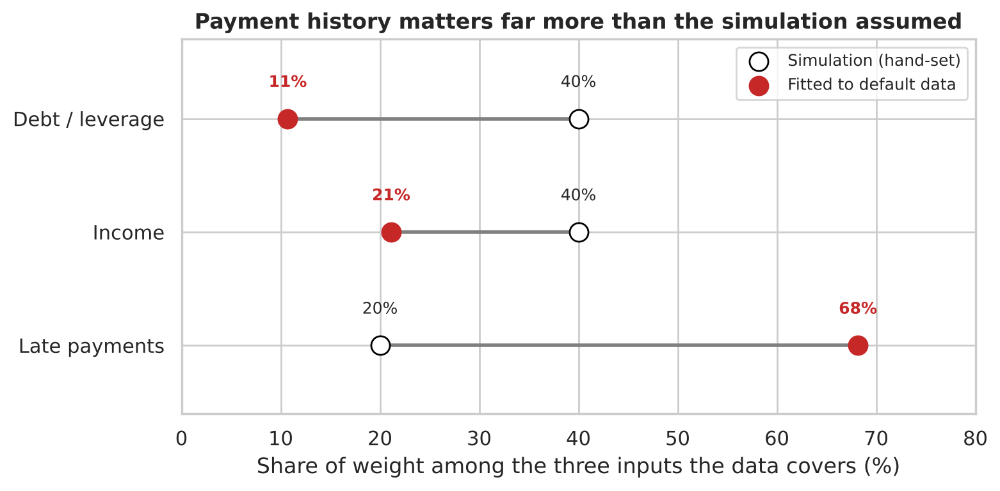

# Risk Analytics and Portfolio Assessment — Goldman Sachs × Forage

*Risk job simulation · August 2026*

Two risk problems, each turned into code that can be tested:

1. **Credit risk.** Profile four prospective borrowers, score their credit risk, and stress-test them under borrower events and recession scenarios.
2. **Real-estate risk.** Map the probability of five property risks (tax hikes, major repairs, falling occupancy, market downturn, new competition) to a mitigation strategy, balancing capital spending (CapEx) against protecting net operating income (NOI).

> **Data note:** the four personas and five property risks come from the Forage job simulation and are fictional. No real client data is used.

---

## Extension: Risk Desk, an interactive tool — [`app/`](app/)

**Live: [pruthav23.github.io/risk-analytics-simulation](https://pruthav23.github.io/risk-analytics-simulation/)**

*Added in November 2026, on top of the original case.*

The case asks you to *grade* each borrower. Risk Desk also works the scorecard **backwards**: for each persona it finds the **smallest single change that moves them to the next risk tier**, such as how much debt to pay down, savings to build or credit-score points to gain. For a borrower already at low risk, it shows the **headroom**: how much savings, income or credit score they could lose before slipping to medium. Every persona in the case came to Goldman Sachs asking for advice, so this turns the scorecard into advice.



Everything in it comes from the case:

- **Live scorecard.** Sliders for income, credit score, debt, savings and late payments, with the score on a risk ladder, debt-to-income, net liquid assets and each attribute's contribution.
- **Real default probability.** Each borrower's two-year probability of default and expected loss, from the model fitted to 118,494 real borrowers (see the calibration section below).
- **Three sets of weights.** Switch between the simulation's original calculator (where paying down debt *lowers* the score), the corrected one, and weights calibrated on real default data. The path to the next tier changes with each.
- **Scenario events.** The six scenario questions as one-click events, with undo. The three the scorecard cannot see are flagged as blind spots.
- **Stress the book.** Income, savings and late-payment shocks with presets for a mild downturn and a severe recession, showing which borrowers drop a tier, how each default probability moves, and total expected loss.
- **Property risk.** Probability sliders for the five property risks drive the mitigation matrix live, with a count of how many risks call for capital spending (CapEx).

What it reveals: **for Personas 2, 3 and 4, building savings is the only single lever that reaches low risk.** Paying off debt entirely, maximising income or a perfect credit score each falls short on its own. That is a property of the scorecard's design: savings carry a 25% weight, capped at $500k.

**How it's built.** One self-contained HTML page with no libraries. `app/build.py` writes the persona data, mitigation matrix and fitted default model into it from the same files the Python analysis uses, and [`tests/test_app.py`](tests/test_app.py) runs the page's model in Node to check that its scores, default probabilities, stress results and thresholds match the Python model exactly, and that every suggested path is the minimum change (one step less does not cross the tier line).

To open it locally: `python app/build.py`, then open `app/index.html` in a browser. To update the live page after a change: `bash app/publish_pages.sh`.

---

## Part 1 — Credit risk profiles

### Key credit metrics — [`scripts/01_credit_profiles.py`](scripts/01_credit_profiles.py)

| | Income | Credit score | Debt | Savings | Late payments | **Debt-to-income** | **Net liquid assets** |
|---|---|---|---|---|---|---|---|
| Persona 1 | $280,000 | 760 | $150,000 | $450,000 | 0 | **53.6%** | **+$300,000** |
| Persona 2 | $180,000 | 700 | $100,000 | $120,000 | 1 | **55.6%** | **+$20,000** |
| Persona 3 | $100,000 | 660 | $90,000 | $20,000 | 2 | **90.0%** | **−$70,000** |
| Persona 4 | $150,000 | 720 | $200,000 | $80,000 | 1 | **133.3%** | **−$120,000** |

- **Debt-to-income (DTI)** here is *total debt ÷ annual income*, a leverage ratio. Lenders' standard DTI uses *monthly debt payments ÷ gross monthly income*, which needs payment data the simulation doesn't provide.
- **Net liquid assets** = savings − debt: the cushion left if every debt were repaid today.



### Weighted risk scorecard

Each attribute is scaled to 0–100 and weighted. A higher score means a *safer* borrower.

| Attribute | Weight | Scaling |
|---|---|---|
| Credit score | 25% | (score − 300) ÷ 550 |
| Annual income | 20% | income ÷ $300k, capped at 100 |
| Debt | 20% | **100 −** debt ÷ $300k |
| Savings | 25% | savings ÷ $500k, capped at 100 |
| Late payments | 10% | **100 −** late payments ÷ 5 |

Risk category: **High ≤ 33 < Medium ≤ 66 < Low**



| Persona | Score | Category | Written assessment |
|---|---|---|---|
| Persona 1 | 82.1 | Low Risk | Very low risk: excellent credit, no late payments, savings cover debt 3× |
| Persona 2 | 57.5 | Medium Risk | Low to moderate: high income, positive but thin liquidity buffer (+$20k), one late payment |
| Persona 4 | 47.8 | Medium Risk | Moderate to high: good credit (720) but debt exceeds income, negative liquidity, seasonal cash flow |
| Persona 3 | 44.0 | Medium Risk | High: 90% DTI, −$70k liquidity, lowest credit score (660), two late payments |

The scorecard ranks the personas in the same order as the written assessment (1 > 2 > 4 > 3). Its Medium band is wide, though, so Personas 3 and 4 both land in Medium even though the written assessment treats them as the riskiest pair.

#### A fix to the simulation's Risk Calculator

The original calculator **added debt and late payments to the score with positive weights**. Since a higher score means lower risk, more debt or more missed payments made a borrower look *safer*. The corrected scorecard uses 100 minus the scaled value for those two attributes. Both versions are shown in the chart (× = original). The [tests](tests/test_models.py) check that the direction is now right.

## Part 2 — Stress testing — [`scripts/02_stress_test.py`](scripts/02_stress_test.py)

### Borrower events

These come from the simulation's scenario questions. Where a question gives no amount, an **illustrative** amount is stated.

| Scenario | Persona | Expected effect | Score | DTI |
|---|---|---|---|---|
| $300k new mortgage without repaying existing debt | 2 | **Increase**: higher total debt | 57.5 → 44.2 | 56% → 222% |
| Debt consolidation (total debt unchanged) | 3 | **Decrease**: simpler repayment, often a lower rate | no change\* | 90% |
| Liquidate $200k of savings to fund a start-up | 1 | **Increase**: smaller liquid buffer | 82.1 → 72.1 | 54% |
| Unused $10k credit card fully drawn | 1 | **Increase (marginal)**: an undrawn limit is potential exposure | 82.1 → 81.4 | 54% → 57% |
| Three-year fixed-salary agreement | 2 | **Decrease**: income is contractually secure | no change\* | 56% |
| $50k business loan repaid on schedule for 2 years | 4 | **Decrease**: proven repayment record | no change\* | 133% |

\* The effect is real, but the scorecard's inputs don't change. These cases show the model's limits: it can't see income stability, debt structure or recent repayment behaviour.

### Macro shocks (all personas)

| Shock | Assumptions | Result |
|---|---|---|
| Mild downturn | Income −15%, savings −20% | No category changes; Persona 4's DTI rises to 157% |
| Severe recession | Income −30%, savings −40%, +1 late payment | **Persona 1 drops from Low to Medium risk** (82.1 → 65.5); Persona 4's DTI reaches 190% |



Even the strongest borrower slips a category in a severe recession. Personas 3 and 4 move closest to the High-risk line, because they have negative net liquid assets to begin with.

## Part 3 — Real-estate risk mitigation matrix — [`scripts/03_mitigation_matrix.py`](scripts/03_mitigation_matrix.py)

Each property risk is assigned a probability **P**, which sets its risk level:

| Level | Threshold | Type of response |
|---|---|---|
| Low | P < 40% | Low-cost, non-disruptive or research-based |
| Medium | 40% ≤ P < 65% | Targeted operating measures that steady cash flow |
| High | P ≥ 65% | Structural or capital-intensive intervention |



**Balancing CapEx against NOI.** Grouping the 15 strategies by the financial lever they use shows the response escalating with risk:

| Lever | Low | Medium | High |
|---|---|---|---|
| Low-cost action / cash reserve | 4 | 0 | 0 |
| Operating cost / cash-flow timing | 0 | 4 | 0 |
| Revenue moves (protect NOI) | 1 | 1 | 2 |
| Capital investment (CapEx) | 0 | 0 | 3 |

At low probability, the matrix avoids spending capital. At high probability, it either invests (renovations, amenities, diversification) or acts directly on revenue (rent increases) so NOI holds up. Full rationale for each choice: [`data/mitigation_matrix.csv`](data/mitigation_matrix.csv).

`risk.mitigation.recommend(matrix, risk, probability)` returns the strategy for any probability. The thresholds are tested at their edges (40% → Medium, 65% → High).

### Errors found in the simulation's mitigation workbook

The workbook's lookup formulas (which pull a justification for the chosen strategy) had mistakes that this implementation avoids:

- **Property taxes, high risk:** the justifications for "tax reassessment" and "rent increase" were swapped.
- **Market downturn:** the medium-risk "adjust rent" option showed the high-risk text, and the high-risk "adjust rent" option pointed to an empty cell.
- **New development competition:** the whole row pulled the *market downturn* justifications instead of its own, and one option pointed to an empty cell.

---

## Extension: testing the weights on real default data — [`scripts/04_calibrate_weights.py`](scripts/04_calibrate_weights.py)

*Added in November 2026.* The simulation's weights were set by hand. To test them, a logistic-regression default model was fitted to Kaggle's **"Give Me Some Credit"** dataset: **118,494 real U.S. borrowers** (after cleaning), each labelled with whether they went 90+ days delinquent within two years.

| Scorecard input | Dataset field |
|---|---|
| Income | Monthly income × 12 |
| Debt | Debt ratio: monthly debt payments ÷ monthly income |
| Late payments | 30–59, 60–89 and 90+ days-late counts, summed |

Each input is scaled 0–100 exactly as the scorecard scales it, so the fitted coefficients can be compared directly. The model scores **AUC 0.79** (Gini 0.58) on borrowers held out from fitting, and its predicted default rates track actual rates decile by decile.



**Finding: payment history matters far more than the simulation assumed.** Among the three inputs the data covers, late payments carry **68%** of the weight, against 20% in the simulation.



The dataset has **no credit score or savings**, so those keep the simulation's 25% each. The calibrated scorecard re-splits only the other 50%: late payments 34.1%, income 10.6%, leverage 5.4%.

### Probability of default for each persona

The personas give total debt, not monthly payments, so debt is assumed to be repaid over 5 years at 8% to estimate payments. Expected loss = PD × LGD (45%, the Basel value for unsecured lending) × exposure (current debt).

| Persona | Payments ÷ income | 2-year PD | Expected loss | Original score | Calibrated score |
|---|---|---|---|---|---|
| Persona 1 | 13.0% | **1.4%** | $925 | 82.1 Low | 92.0 Low |
| Persona 2 | 13.5% | **4.5%** | $2,026 | 57.5 Medium | 62.4 Medium |
| Persona 4 | 32.4% | **5.7%** | $5,109 | 47.8 Medium | 59.3 Medium |
| Persona 3 | 21.9% | **13.4%** | $5,428 | 44.0 Medium | 45.5 Medium |

The PDs rank the personas in the same order as the written assessment, and they separate Persona 3 (two late payments) clearly from Persona 4, which the original scorecard could not.

**Reproducing it.** The Kaggle data can't be redistributed, so it isn't in this repo; the fitted results are saved in [`results/calibration.json`](results/calibration.json) and everything above runs from that. To refit, download `cs-training.csv` from [kaggle.com/c/GiveMeSomeCredit](https://www.kaggle.com/c/GiveMeSomeCredit/data) into `data/external/` and run `python run_all.py`; a test confirms the refit matches the saved coefficients.

**Caveats.** The dataset is from a 2011 competition, and its "default" is 90+ days delinquent rather than charge-off. The model uses only the three inputs that map onto the case. Adding revolving-credit utilisation and age, which the dataset also has, lifts AUC to about 0.84, but the personas don't have those fields.

---

## Limitations

- **Credit score and savings weights remain hand-set.** The calibration above covers income, leverage and payment history; the dataset has no credit score or savings.
- **Absolute debt, not leverage, drives the original debt score.** A $200k debt scores the same at any income. The calibrated scorecard uses payments ÷ income instead.
- **Stress assumptions are illustrative.** Shocks are uniform across personas. Persona 4's seasonal income would realistically take a larger hit.
- Persona 4's income appears as "$150,00" in the simulation brief and is taken as **$150,000**.

## Repo structure

```
├── data/
│   ├── personas.csv             # 4 borrower personas
│   └── mitigation_matrix.csv    # 5 risks x 3 levels: strategy, lever, rationale
├── risk/                        # model code
│   ├── credit.py                # DTI, net liquid assets, weighted scorecard
│   ├── stress.py                # borrower events and macro shocks
│   ├── mitigation.py            # probability thresholds -> strategy
│   └── calibration.py           # default model fitted to real data, PD, expected loss
├── scripts/                     # reports and charts
│   ├── 01_credit_profiles.py
│   ├── 02_stress_test.py
│   ├── 03_mitigation_matrix.py
│   └── 04_calibrate_weights.py
├── app/                         # Risk Desk interactive tool
│   ├── template.html            # page source
│   ├── build.py                 # fills in the CSV data -> index.html
│   ├── index.html               # built page, opens in any browser
│   └── publish_pages.sh         # pushes the page to GitHub Pages (gh-pages branch)
├── tests/
│   ├── test_models.py           # 16 tests: score direction, thresholds, metrics
│   ├── test_app.py              # 5 tests: the page's model matches the Python model
│   └── test_calibration.py      # 8 tests: coefficient signs, AUC, PD ranking, refit
├── figures/
├── results/
│   ├── analysis_output.txt      # full printed output
│   └── calibration.json         # fitted default model
└── run_all.py
```

## How to run

```bash
pip install -r requirements.txt
python run_all.py        # regenerates figures/ and results/
python app/build.py      # rebuilds the Risk Desk page
python -m pytest tests   # runs the checks (the page tests need Node.js)
```
