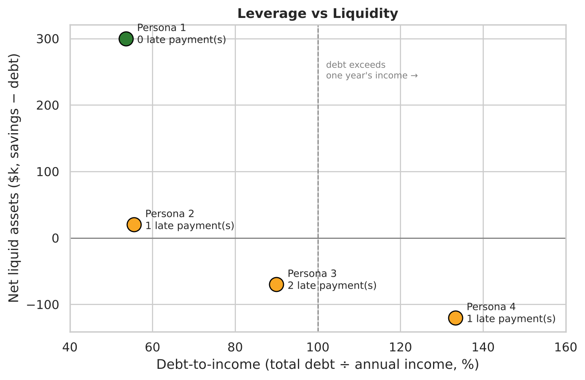
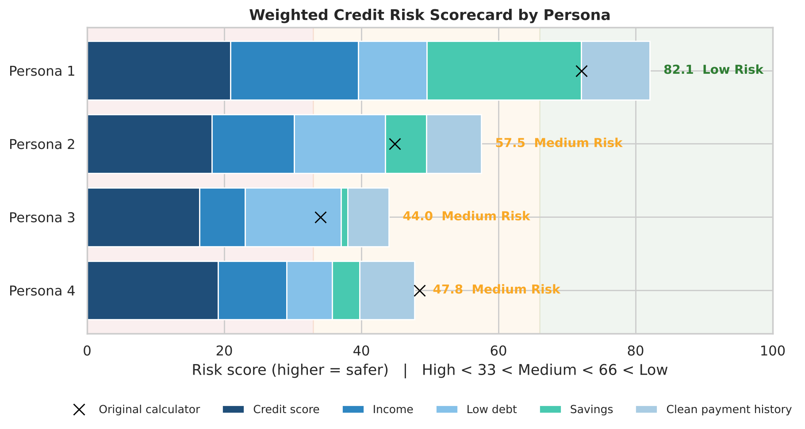
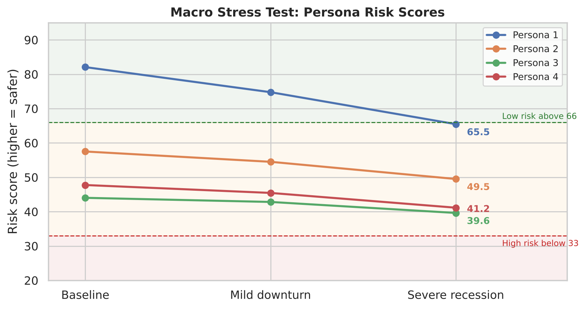
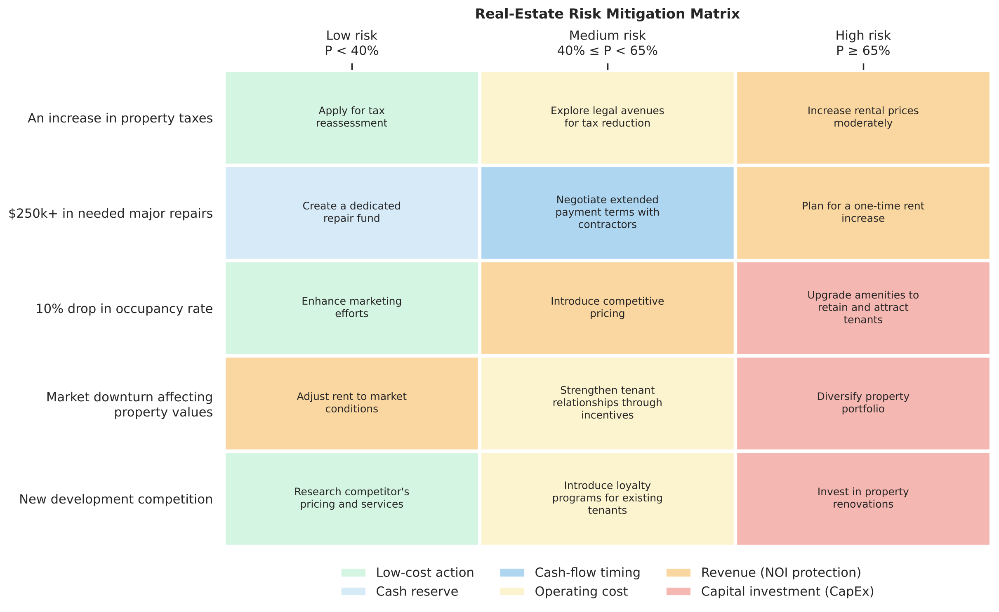

# Risk Analytics and Portfolio Assessment — Goldman Sachs × Forage

*Risk job simulation · August 2026*

Two risk problems, each turned into code that can be tested:

1. **Credit risk.** Profile four prospective borrowers, score their credit risk, and stress-test them under borrower events and recession scenarios.
2. **Real-estate risk.** Map the probability of five property risks (tax hikes, major repairs, falling occupancy, market downturn, new competition) to a mitigation strategy, balancing capital spending (CapEx) against protecting net operating income (NOI).

> **Data note:** the four personas and five property risks come from the Forage job simulation and are fictional. No real client data is used.

---

## Part 1 — Credit risk profiles

### Key credit metrics — [`scripts/01_credit_profiles.py`](scripts/01_credit_profiles.py)

| | Income | Credit score | Debt | Savings | Late payments | **Debt-to-income** | **Net liquid assets** |
|---|---|---|---|---|---|---|---|
| Persona 1 | $280,000 | 760 | $150,000 | $450,000 | 0 | **53.6%** | **+$300,000** |
| Persona 2 | $180,000 | 700 | $100,000 | $120,000 | 1 | **55.6%** | **+$20,000** |
| Persona 3 | $100,000 | 660 | $90,000 | $20,000 | 2 | **90.0%** | **−$70,000** |
| Persona 4 | $150,000 | 720 | $200,000 | $80,000 | 1 | **133.3%** | **−$120,000** |

- **Debt-to-income (DTI)** here is *total debt ÷ annual income*, a leverage ratio. Lenders' standard DTI uses *monthly debt payments ÷ gross monthly income*, which needs payment data the simulation doesn't provide.
- **Net liquid assets** = savings − debt: the cushion left if every debt were repaid today.



### Weighted risk scorecard

Each attribute is scaled to 0–100 and weighted. A higher score means a *safer* borrower.

| Attribute | Weight | Scaling |
|---|---|---|
| Credit score | 25% | (score − 300) ÷ 550 |
| Annual income | 20% | income ÷ $300k, capped at 100 |
| Debt | 20% | **100 −** debt ÷ $300k |
| Savings | 25% | savings ÷ $500k, capped at 100 |
| Late payments | 10% | **100 −** late payments ÷ 5 |

Risk category: **High ≤ 33 < Medium ≤ 66 < Low**



| Persona | Score | Category | Written assessment |
|---|---|---|---|
| Persona 1 | 82.1 | Low Risk | Very low risk: excellent credit, no late payments, savings cover debt 3× |
| Persona 2 | 57.5 | Medium Risk | Low to moderate: high income, positive but thin liquidity buffer (+$20k), one late payment |
| Persona 4 | 47.8 | Medium Risk | Moderate to high: good credit (720) but debt exceeds income, negative liquidity, seasonal cash flow |
| Persona 3 | 44.0 | Medium Risk | High: 90% DTI, −$70k liquidity, lowest credit score (660), two late payments |

The scorecard ranks the personas in the same order as the written assessment (1 > 2 > 4 > 3). Its Medium band is wide, though, so Personas 3 and 4 both land in Medium even though the written assessment treats them as the riskiest pair.

#### A fix to the simulation's Risk Calculator

The original calculator **added debt and late payments to the score with positive weights**. Since a higher score means lower risk, more debt or more missed payments made a borrower look *safer*. The corrected scorecard uses 100 minus the scaled value for those two attributes. Both versions are shown in the chart (× = original). The [tests](tests/test_models.py) check that the direction is now right.

## Part 2 — Stress testing — [`scripts/02_stress_test.py`](scripts/02_stress_test.py)

### Borrower events

These come from the simulation's scenario questions. Where a question gives no amount, an **illustrative** amount is stated.

| Scenario | Persona | Expected effect | Score | DTI |
|---|---|---|---|---|
| $300k new mortgage without repaying existing debt | 2 | **Increase**: higher total debt | 57.5 → 44.2 | 56% → 222% |
| Debt consolidation (total debt unchanged) | 3 | **Decrease**: simpler repayment, often a lower rate | no change\* | 90% |
| Liquidate $200k of savings to fund a start-up | 1 | **Increase**: smaller liquid buffer | 82.1 → 72.1 | 54% |
| Unused $10k credit card fully drawn | 1 | **Increase (marginal)**: an undrawn limit is potential exposure | 82.1 → 81.4 | 54% → 57% |
| Three-year fixed-salary agreement | 2 | **Decrease**: income is contractually secure | no change\* | 56% |
| $50k business loan repaid on schedule for 2 years | 4 | **Decrease**: proven repayment record | no change\* | 133% |

\* The effect is real, but the scorecard's inputs don't change. These cases show the model's limits: it can't see income stability, debt structure or recent repayment behaviour.

### Macro shocks (all personas)

| Shock | Assumptions | Result |
|---|---|---|
| Mild downturn | Income −15%, savings −20% | No category changes; Persona 4's DTI rises to 157% |
| Severe recession | Income −30%, savings −40%, +1 late payment | **Persona 1 drops from Low to Medium risk** (82.1 → 65.5); Persona 4's DTI reaches 190% |



Even the strongest borrower slips a category in a severe recession. Personas 3 and 4 move closest to the High-risk line, because they have negative net liquid assets to begin with.

## Part 3 — Real-estate risk mitigation matrix — [`scripts/03_mitigation_matrix.py`](scripts/03_mitigation_matrix.py)

Each property risk is assigned a probability **P**, which sets its risk level:

| Level | Threshold | Type of response |
|---|---|---|
| Low | P < 40% | Low-cost, non-disruptive or research-based |
| Medium | 40% ≤ P < 65% | Targeted operating measures that steady cash flow |
| High | P ≥ 65% | Structural or capital-intensive intervention |



**Balancing CapEx against NOI.** Grouping the 15 strategies by the financial lever they use shows the response escalating with risk:

| Lever | Low | Medium | High |
|---|---|---|---|
| Low-cost action / cash reserve | 4 | 0 | 0 |
| Operating cost / cash-flow timing | 0 | 4 | 0 |
| Revenue moves (protect NOI) | 1 | 1 | 2 |
| Capital investment (CapEx) | 0 | 0 | 3 |

At low probability, the matrix avoids spending capital. At high probability, it either invests (renovations, amenities, diversification) or acts directly on revenue (rent increases) so NOI holds up. Full rationale for each choice: [`data/mitigation_matrix.csv`](data/mitigation_matrix.csv).

`risk.mitigation.recommend(matrix, risk, probability)` returns the strategy for any probability. The thresholds are tested at their edges (40% → Medium, 65% → High).

### Errors found in the simulation's mitigation workbook

The workbook's lookup formulas (which pull a justification for the chosen strategy) had mistakes that this implementation avoids:

- **Property taxes, high risk:** the justifications for "tax reassessment" and "rent increase" were swapped.
- **Market downturn:** the medium-risk "adjust rent" option showed the high-risk text, and the high-risk "adjust rent" option pointed to an empty cell.
- **New development competition:** the whole row pulled the *market downturn* justifications instead of its own, and one option pointed to an empty cell.

---

## Limitations

- **The scorecard is rule-based, not a calibrated probability-of-default model.** There's no historical default data in the simulation to fit one. Its weights and caps come from the simulation's calculator.
- **Absolute debt, not leverage, drives the debt score.** A $200k debt scores the same at any income. Using DTI instead would separate Personas 3 and 4 more clearly from Persona 2.
- **Stress assumptions are illustrative.** Shocks are uniform across personas. Persona 4's seasonal income would realistically take a larger hit.
- Persona 4's income appears as "$150,00" in the simulation brief and is taken as **$150,000**.

## Repo structure

```
├── data/
│   ├── personas.csv             # 4 borrower personas
│   └── mitigation_matrix.csv    # 5 risks x 3 levels: strategy, lever, rationale
├── risk/                        # model code
│   ├── credit.py                # DTI, net liquid assets, weighted scorecard
│   ├── stress.py                # borrower events and macro shocks
│   └── mitigation.py            # probability thresholds -> strategy
├── scripts/                     # reports and charts
│   ├── 01_credit_profiles.py
│   ├── 02_stress_test.py
│   └── 03_mitigation_matrix.py
├── tests/test_models.py         # 16 tests: score direction, thresholds, metrics
├── figures/
├── results/analysis_output.txt  # full printed output
└── run_all.py
```

## How to run

```bash
pip install -r requirements.txt
python run_all.py        # regenerates figures/ and results/
python -m pytest tests   # runs the checks
```
